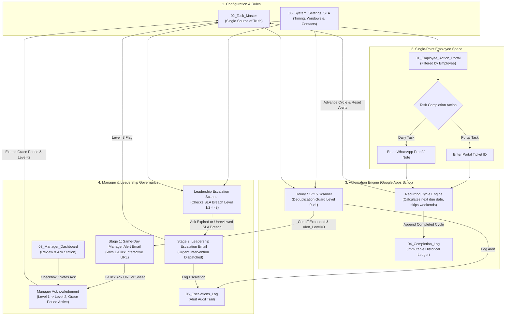

# Allo Innoware — Recurring Task Tracking, Pending Reports & Escalation Automation

## 1. Executive Summary & System Architecture

### 1.1 Business Context & Problem Statement
**Allo Innoware** coordinates multi-cadence recurring operational tasks across key team members (Daily, every 7 days, every 15 days, and every 30 days). In conventional operational setups, distributed recurring tasks suffer from critical failure modes:
1. **Schedule Drift & Manual Date Arithmetic**: Employees forget when tasks are due or manually calculate recurrence dates, resulting in missed cycles.
2. **Duplication of Effort & Dispersed Portals**: Employees are forced to check one sheet, complete work in another portal, and manually update status across multiple tracking logs.
3. **Unstructured Daily Task Verification**: Daily tasks (such as posting morning operational summaries in a WhatsApp group) lack formal ticket IDs, leading to ambiguous completion tracking.
4. **Lack of Proactive Governance**: Overdue tasks sit unnoticed until downstream operations break; managers lack a consolidated view, and leadership only learns of bottlenecks post-crisis.
5. **Alert Fatigue & Duplicate Spam**: Naive automation scripts continuously flood inboxes with repetitive reminders every time a scheduled timer fires.

To resolve these challenges, we have designed and built a production-grade, Google Sheets-centered operational governance platform powered by Google Apps Script and structured mathematical state machines.

---

### 1.2 End-to-End System Architecture

---

### 1.3 Core Architectural Principles

1. **Strict Idempotency & Zero Duplicate Alerts (Test 8 Guard)**:
   The core engine utilizes an explicit 4-state finite state machine (`Alert_Level`: 0 = Normal, 1 = Manager Alerted, 2 = Manager Acknowledged, 3 = Leadership Escalated). Once an alert stage fires, the state locks. Running the scan 1 time or 100 times produces **exactly one alert**, completely eliminating notification spam.

2. **Single-Point Employee Console (Zero Effort Duplication)**:
   Employees never navigate into master tables, configuration tabs, or historical audit logs. Everything—viewing pending tasks, reviewing cut-offs, typing Ticket IDs, entering WhatsApp confirmation proofs, and submitting completion—occurs in **`01_Employee_Action_Portal`**.

3. **Intelligent Recurrence Arithmetic**:
   The engine advances recurring cycles based on anchored recurrence logic:
   - **Daily Tasks**: Advances to the next calendar date; skips Saturdays/Sundays automatically if working days are enabled.
   - **7-Day Tasks**: Adds 7 calendar days to the scheduled due date to preserve operational cadence.
   - **15-Day Tasks**: Adds 15 calendar days.
   - **30-Day Tasks**: Adds 30 calendar days.

4. **Multi-Channel Manager Governance (In-Sheet & 1-Click Email)**:
   Managers can review and acknowledge overdue tasks directly from their mobile email inbox via an encrypted 1-click webhook link (`doGet`) or from the interactive review console in `03_Manager_Dashboard`.

5. **Tamper-Evident Historical Audit Trail**:
   Every completion is written to `04_Completion_Log` with user email, timestamp, cycle number, turnaround SLA (ON-TIME vs. LATE), and proof value. Active task rows in `02_Task_Master` only hold current-cycle pointers.

---

### 1.4 Deliverables Included in this Package

| Component | Path / Location | Purpose |
|---|---|---|
| **Google Sheets Prototype** | `Allo_Innoware_Recurring_Task_System.xlsx` | 6-sheet production prototype with formulas, KPI cards, validations, and interactive portals. |
| **Google Apps Script Codebase** | `google_apps_script/*.js` | Complete, modularized JavaScript source code ready for Google Sheets Extensions -> Apps Script. |
| **Standalone Python Test Suite** | `tests/simulate_tests.py` | Local simulation engine executing all 8 Assignment Tests with verified assertions and JSON output. |
| **Test Execution Audit Log** | `tests/test_results.json` | Detailed output records, email dispatch logs, and completion ledgers for all 8 tests. |
| **Daily Task Strategy Document** | `docs/02_DAILY_TASK_COMPLETION_STRATEGY.md` | In-depth engineering proposal for frictionless daily WhatsApp task tracking. |
| **SLA & Escalation Timing Matrix** | `docs/03_MANAGER_ALERTS_AND_LEADERSHIP_ESCALATION_SLA.md` | Mathematical SLA framework, cut-off schedules, grace periods, and deduplication logic. |
| **Demonstration & Test Cases Report** | `docs/04_TEST_CASES_AND_DEMONSTRATION_REPORT.md` | Step-by-step verification report for Tests 1 through 8. |
| **Google Sheets Deployment Guide** | `docs/05_GOOGLE_SHEETS_SETUP_AND_DEPLOYMENT_GUIDE.md` | Step-by-step tutorial to deploy, configure, and operate the system in Google Workspace. |
