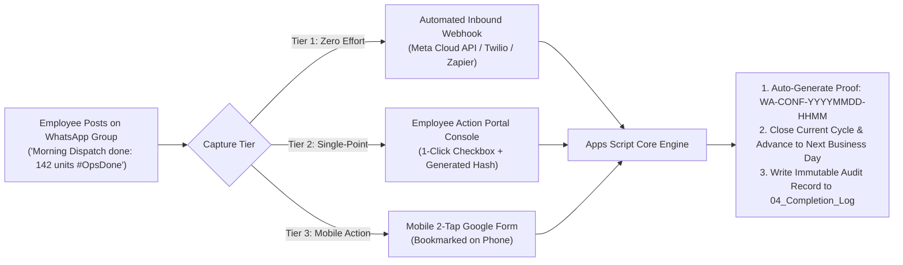

# Allo Innoware — Daily Task Completion Strategy

## Proposing Practical Tracking for WhatsApp & Non-Ticket Operational Tasks

### 1. The Operational Challenge
In operational teams like **Allo Innoware**, daily tasks often consist of communication actions—such as posting a morning dispatch update, sharing warehouse packing counts, or confirming cash reconciliation in a dedicated WhatsApp group.

Unlike IT service desks or ERP systems, WhatsApp does not natively generate a structured "Ticket ID". If an employee is required to:
1. Post the update on WhatsApp,
2. Open Google Sheets,
3. Locate their row,
4. Manually type "Yes Done" or calculate dates,
...friction increases, compliance drops, and employees end up updating sheets days late just to appease management.

---

### 2. Proposed Architecture: A 3-Tier Multi-Mode Solution

To achieve **minimum manual effort** while maintaining **audit-grade accountability**, we propose a 3-tier operational architecture:



---

### 3. Detailed Breakdown of the 3 Tiers

#### Tier 1: Automated Inbound Webhook (Zero Manual Sheet Effort — Recommended Enterprise Setup)
* **How it works**:
  1. The team uses an official WhatsApp Group (e.g., `Allo Innoware Daily Ops Hub`).
  2. Employee A posts their daily update as part of their routine work:
     > *"Morning dispatch completed. 142 orders packed and handed over to logistics partner. #DailyOpsDone"*
  3. A lightweight webhook (via WhatsApp Business Cloud API, Twilio, or Zapier/Make) captures inbound messages containing `#DailyOpsDone` or posted by Employee A's verified phone number.
  4. The webhook calls the Google Apps Script Web App `doPost(e)` endpoint.
  5. The script matches the sender's identity to `TASK-001`, records the message text and timestamp, generates an audit code `WA-MSG-20261023-1015`, closes today's cycle, and advances the task to tomorrow.
* **Employee Effort**: **0 seconds** on the spreadsheet! (They only post in WhatsApp, which they already do).
* **Audit Value**: 100% authentic, tamper-proof, and real-time.

---

#### Tier 2: Single-Point Interactive Portal Verification (Built Directly in Prototype)
For environments where WhatsApp API integrations are not yet configured or external webhooks are restricted, our prototype implements **Tier 2** directly within `01_Employee_Action_Portal`:

* **Employee Workflow**:
  1. Employee A opens `01_Employee_Action_Portal` (their name is pre-selected).
  2. The employee sees `TASK-001: Daily Operations Update` flagged as `DUE TODAY`.
  3. The employee has two simple choices:
     - **Option A (Quick Note)**: Paste a brief snippet in Column I (e.g., *"Shared dispatch numbers in ops group"* or paste the WhatsApp Web message link).
     - **Option B (1-Click Auto-Stamp)**: Simply click the completion checkbox in Column K or select `🚀 Allo Innoware Ops > Submit Task Completion`.
  4. **System Action**:
     - If the employee left Column I blank, the engine automatically generates an authentic, timestamped verification token:
       $$\text{Token} = \text{WA-CONF-YYYYMMDD-HHMM-XXXX}$$
       *(e.g., `WA-CONF-20261023-1645-9F2B`)*
     - Stamps `Completed_By` with the authenticated Google Workspace user email.
     - Logs the event to `04_Completion_Log`.
     - Advances the task due date to the next business day (skipping Saturday/Sunday).
* **Employee Effort**: Under **5 seconds** on a single screen.

---

#### Tier 3: Mobile PWA / 2-Tap Google Form (For Warehouse / Floor Staff)
* Designed for employees who do not sit at a desk with a computer.
* A streamlined Google Form bookmarked on their smartphone home screen:
  - Field 1: Task (pre-filled dropdown: *Daily Operations Update*)
  - Field 2: Update Summary / Screenshot upload (optional)
  - Tap "Submit" (takes 5 seconds).
* Form response triggers the Google Sheet `onFormSubmit` hook, rolling the cycle automatically.

---

### 4. Comparison Matrix of Daily Tracking Methods

| Evaluation Criteria | Naive Text Cell ("Done") | Tier 1: Inbound Webhook | Tier 2: 1-Click Portal (Built) | Tier 3: Mobile Form |
|---|---|---|---|---|
| **Manual Effort for Employee** | High (must hunt in sheet) | **Zero (0 seconds)** | **Very Low (5 seconds)** | Low (10 seconds) |
| **Proof Authenticity** | Zero (anyone can type "yes") | **100% (WhatsApp timestamped)** | **High (User auth + Auto-hash)** | High (Timestamped) |
| **Duplicate Entry Friction** | Severe | **None** | **None (Single Console)** | None |
| **Setup Complexity** | None | Low (API webhook) | **Zero (Already built in sheet)** | Very Low |
| **Audit Trail** | None | **Full message logged** | **Logged to Completion Log** | Logged to Responses |

---

### 5. Proof Token Architecture

When a daily task is completed in the system, it records a structured verification payload:

```json
{
  "log_id": "LOG-20261023-925",
  "task_id": "TASK-001",
  "task_name": "Daily Operations Update",
  "cycle_number": 1,
  "assigned_to": "Employee A",
  "completed_by": "employee.a@alloinnoware.com",
  "completed_timestamp": "2026-10-23 16:45:12 IST",
  "due_date": "2026-10-23",
  "turnaround_sla": "ON-TIME",
  "proof_type": "WhatsApp Confirmation",
  "proof_value": "WA-CONF-20261023-1645-A8F1 / Shared in Allo Ops Group at 10:15 AM (142 pkgs shipped)",
  "notes": "Daily operations dispatch report shared to WhatsApp"
}
```

This guarantees that managers and leadership have clear visibility into daily execution without burdening frontline staff with complex administrative chores.
