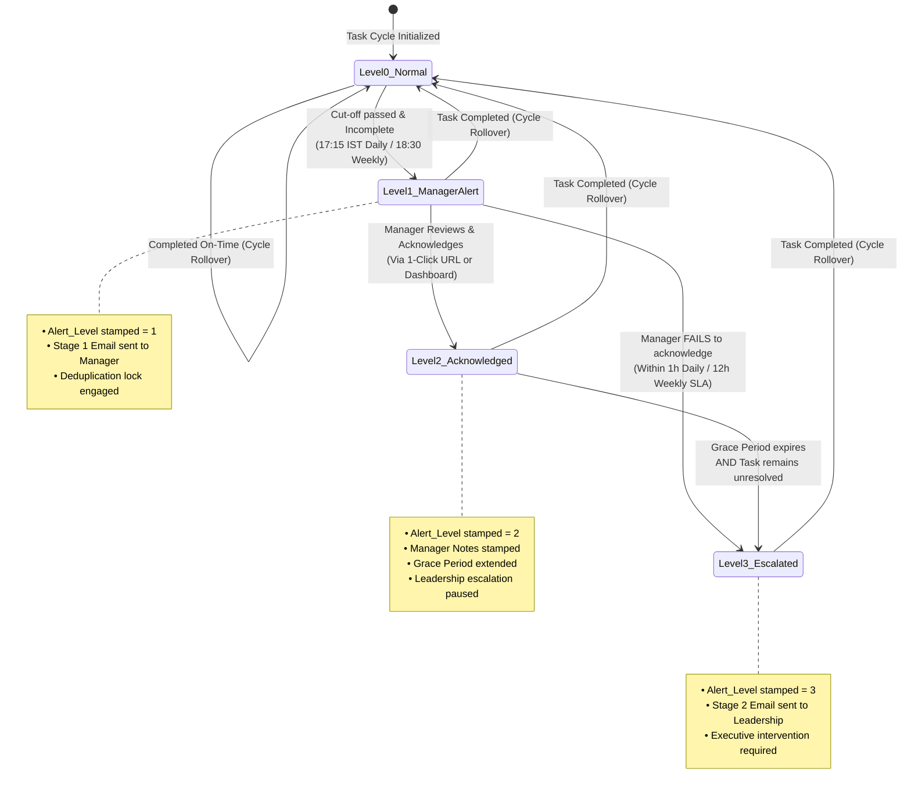

# Allo Innoware — Manager Alerts & Leadership Escalation SLA Framework

## Operational Timing Logic, State Machine Governance & Deduplication Architecture

### 1. The Governance Philosophy
Operational escalations must satisfy three non-negotiable criteria:
1. **Punctuality**: Alerts must trigger swiftly enough so corrective action can be taken *before* business operations are impaired.
2. **Actionability**: Alerts must provide context and clear resolution mechanisms, not just passive notifications.
3. **Deduplication / Noise Suppression**: Repetitive emails cause alert fatigue. If a manager receives 15 emails about the same overdue task every hour, they will configure an inbox rule to archive them all.

To achieve this, our system establishes a **Deterministic 4-State Governance Machine** combined with a **Cadence-Calibrated SLA Timing Matrix**.

---

### 2. SLA Timing Matrix: Proposed Operational Schedule

The timing of alerts and escalations varies logically based on task recurrence frequency:

| Recurrence Frequency | Scheduled Due Time | Employee Warning Window | Stage 1: Same-Day Manager Alert | Manager Review SLA Window | Stage 2: Leadership Escalation | Timing Reasoning |
|---|---|---|---|---|---|---|
| **Daily Tasks**<br/>*(e.g., Ops Update)* | **17:00 IST** (Working Days) | 16:00 IST *(1 hr prior)* | **17:15 IST** *(15 mins past cut-off)* | **1.0 Hour** *(Until 18:15 IST)* | **18:30 IST** *(Same Evening)* | Daily tasks impact tomorrow morning's operations. If not resolved before evening close of business (18:30 IST), leadership must intervene immediately. |
| **Every 7 Days**<br/>*(e.g., Portal Task A)* | **18:00 IST** on Due Date | 09:00 IST morning of Due Date | **18:30 IST** on Due Date | **12.0 Hours** *(Until next morning 09:00 IST)* | **12:00 IST next working day** *(24 hrs overdue)* | Weekly tasks carry moderate urgency; giving the manager until next morning allows them to follow up with the team at the morning stand-up. |
| **Every 15 Days**<br/>*(e.g., Portal Task B)* | **18:00 IST** on Due Date | 24 Hours prior to Due Date | **18:30 IST** on Due Date | **24.0 Hours** *(Next day 18:30 IST)* | **+48.0 Hours** past Due Date | Bi-weekly tasks usually depend on external portal data or reconciliations; 24h review allows cross-departmental coordination. |
| **Every 30 Days**<br/>*(e.g., Portal Task C)* | **18:00 IST** on Due Date | 48 Hours prior to Due Date | **18:30 IST** on Due Date | **24.0 Hours** *(Next day 18:30 IST)* | **+48.0 Hours** past Due Date | Monthly statutory/compliance tasks require substantial document preparation; escalation allows executive intervention before legal/contractual deadlines. |

---

### 3. State Machine Governance: Flowchart

The system tracks every active task through an explicit lifecycle state (`Alert_Level` 0 to 3):



---

### 4. Manager Action & Review Workflow (Addressing Test 5)

When a manager receives a **Stage 1 Same-Day Alert Email**, they are not expected to merely read it—they must perform an active governance action:

#### Expected Manager Action
1. **Inspect Root Cause**: Check why the employee has not finished (e.g., portal is down, client delayed information, or employee is on unscheduled leave).
2. **Acknowledge the Issue**:
   - **Method A (1-Click Email Webhook)**: Click the secure button in the email:
     $$\text{https://script.google.com/macros/s/.../exec?action=ack\&taskId=TASK-003}$$
   - **Method B (Manager Command Dashboard)**: On `03_Manager_Dashboard`, check the `Manager Acknowledged?` box in Row 18 and enter action notes (e.g., *"Contacted Employee C; vendor API down; granting 2h extension"*).
   - **Method C (Ops Menu)**: Select `🚀 Allo Innoware Ops > Manager Acknowledge Overdue Task`.

#### System Behavior upon Manager Acknowledgment
- Sets `Alert_Level = 2` (Acknowledged).
- Stamps `Manager_Ack_At = now()` and records `Manager_Notes`.
- **Pauses Leadership Escalation**: The system grants an extended grace period (e.g. +1 hour for daily tasks, +12 hours for weekly tasks).
- **Audit Logging**: The acknowledgment timestamp and manager email are permanently logged into `05_Escalations_Log`.

#### Post-Acknowledgment Scenarios
- **Scenario 1 (Resolved)**: The employee completes the task within the grace period. The system closes the cycle, stamps the log, and resets `Alert_Level = 0`. **Zero escalation to leadership!**
- **Scenario 2 (Unresolved)**: The grace period expires and the task is still pending. The system automatically elevates the task to `Alert_Level = 3` and escalates to leadership.

---

### 5. Deduplication & Idempotency Engine (Addressing Test 8)

To guarantee that running scheduled timers (e.g., every 15 minutes or hourly) never produces duplicate task cycles or email spam, the engine enforces strict **Idempotency Rules**:

1. **State-Level Gating**:
   ```javascript
   // In ManagerAlerts.gs
   if (task.alertLevel >= 1 || task.lastManagerAlertAt) {
     duplicateSkipped++;
     continue; // Strictly bypass alert generation!
   }
   ```
2. **Escalation Gating**:
   ```javascript
   // In LeadershipEscalation.gs
   if (task.alertLevel === 3 || task.leadershipEscalatedAt) {
     duplicateSkipped++;
     continue; // Leadership already alerted for this cycle!
   }
   ```
3. **Cycle-Level Reset**:
   When `rolloverTaskCycle()` is called, all alert flags (`alert_level`, `last_manager_alert_at`, `leadership_escalated_at`, `manager_ack_at`) are wiped clean for the **new cycle only**. The previous cycle remains recorded in the historical log.
4. **Result**: Whether the hourly monitor runs once or 100 times, **exactly one manager alert** and **exactly one leadership escalation** can occur per cycle breach.
